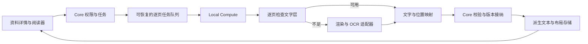

# AcademicCloud OCR 功能规划草案

日期：2026-09-27。状态：**讨论稿；已完成本地复用检查，尚未转为生产实施任务或已接受 ADR**。

2026-09-28 Owner 更新：完成当前编目恢复后，评估并推进正式 OCR 接入，目标是书籍编目证据更可靠及`我的研究`的当前页 OCR。当前页是本次实施边界；下文整份文档、公开机器文本和全文处理仍是原讨论稿建议，不是新授权范围。先明确私人结果的源/页身份、任务/结果持久化、权限和回退，资格通过后纳入统一发布。现有接口仍返回`ocr_deferred`，尚未实现识别或文本入库。

### 最新选择顺序 — 2026-09-28

Owner 随后要求分场景处理成员本地 OCR，并优先评估在线 OCR。以 [ADR048](../decisions/ADR-048-private-current-page-ocr.md) 和[在线评估](../evaluation/online-ocr-options.md)为当前边界：统一入口由成员连接自己的线上服务或本地引擎，弹窗内必须有简单教程。允许合理 OCR 费用，先看实测再定预算；未采纳任何预设金额。提供商尚未选定；成员本地识别在其自己的设备运行，不自动消耗 Owner 密钥、额度或算力。原有书目 Local Pull 保持不变。未使用的任务/缓存040草案已归档，下面早先 Local Pull 接入方案仅保留为曾评估的候选，不能视为已接受的默认架构。

### 早先当前页 Local Pull 候选可行性 — 2026-09-28

现有 Paddle 可作为本地资格基线；最新指示已将首版引擎选择改为在线评估优先。只读检查确认 V2 计算环境正在运行，
固定的 Paddle GPU3.3.1、PaddleOCR3.7.0 和 v6_small det/rec 资产已存在；
两个模型参数文件的现场 SHA256 与既有 pin 匹配。该检查未运行推理、下载模型、
更改服务或处理真实页面，因此是运行前提证据，不是文字质量验收。

早先 Local Pull 候选路径为（尚未采用）：`我的研究`已显示的 PDF 当前物理页 → 显式识别 →
私有持久任务 → 本地单页计算 → 原页旁展示可复制的未校对文本。刷新后可以
恢复该账号的任务及成果。页图只在计算过程临时存在；机器文字不自动写入笔记、
不公开用户的阅读页/请求时间，也不自动成为 canonical 书目。

| 必须补齐的实现 | 具体要求 |
|---|---|
| 源与账号权限 | 提交、领取、续权、接纳、读取均验证当前账号、资料访问权、current sourceId 和字节身份；登录校验本身不够 |
| 单页任务合同 | 202 返回持久任务身份，另有状态/结果读取；只开放 single，锁定一基物理页与管线版本，服务端严格解析结果 |
| 私人任务/结果存储 | 新 ADR 冻结表结构、文本大小/保留额度、尝试/幂等/取消和旧源失效；不混入共享 Library Activity 或既有书目候选表 |
| Worker 调度 | 复用一个 Local Pull 执行器和独立心跳；单页任务与编目有界公平调度；旧 worker 不得把 OCR 当书目领取 |
| 页提取适配 | 复用 Range、PDF.js 渲染与 Paddle 底层，新增 explicit-page 路径；现 FrontMatterInspector 固定前15/后5页，不能充当任意页入口 |
| Reader 交互 | 使用实际 renderedPage 和 resourceId/sourceId 冻结请求；翻页、换书、换源后晚到结果不串页；先做文字对照，不伪造未提供的文字框 |
| 部署与回退 | 迁移、Core/Compute 能力准入及启用顺序一起评审；保留未完任务和已保存文本，旧运行时不得误领新任务 |

当前 `derived_compute_jobs` 的 SQL kind 约束、旧列表查询、SuggestionService 与
worker 都仅面向 `metadata_suggestion`。正式持久接入需要明确迁移和路由；
不能仅放宽一个类型或把 UnavailableReaderOcrBackend 换成可用实现。具体采用
扩展通用队列还是独立 sidecar 表，应在实施 ADR 中按旧 worker 隔离与回退验证决定。

书目可靠性使用另一条验收线：先以题名页/版权页等可核对来源标记字段缺口，
分清窗口未覆盖、每页/总输入截断、OCR 错误、模型遗漏及 validator 拒绝。
显式补充证据页需要有界请求和独立处理版本；不把 Reader 私人机器文本直接
送入共享 canonical 写入。保留现有 v11 证据、人工权威和 CAS 规则。

验收先覆盖真实引擎单页渲染/取消/资源上限，再用未用于调整的来源页和独立人工真值
分别核对字符、漏字、阅读顺序与书目字段。汉文竖排、多栏夹注、坏文字层、旋转页
和中西混排仍需实测，不能由模型支持列表推定。Mongology 的拉丁转写/西文学术行
模型保留为专用候选；既有合成输入不证明传统竖排蒙古文能力，不作为首版强依赖。

识别字典现场检查包含大量汉字和部分拉丁转写字母，但不含 U+1800–18AF
传统蒙古文字元；原生 PDF 蒙古文读取测试不能证明扫描蒙古文 OCR。现 sidecar
关闭方向检测，按引擎原序拼接，且低于55分会丢弃文字。Reader 的低分/无字/不支持
状态需要独立保留，不能将这些情况都标为成功空白。

最小后续资格建议为12个合成页与8个来自至少4份来源的真实有界页：覆盖横排汉英、
复杂汉文、转写字符、空白/图片、旋转、混合/坏文字层及超限取消。真实页须独立真值，
训练已用书不作盲测。分别记录冷/热启动、RSS/VRAM、Range字节、页状态、CER、
码位保真及关键书目字段；现有小英文合成图毫秒级耗时不代表整页或整书性能。
现12份Owner保留PDF尚无已确认传统蒙古文或转写真值页，这些文字不得被伪报为通过。

当前结论是接入可行且实现边界明确，尚未启用当前页识别或保存 OCR 文本。

本轮 Owner 授权开始规划、继续离线复用检查，并要求与“提升书籍录入可靠性”协作。本文按当前 vNext 基线 `7bb7959` 修订，建议复用 Mongology Academic OCR 与已有 Paddle 路线，将识别结果接入现有 Reader。唯一活动集成任务为 `ACADEMICCLOUD-VNEXT-REMEDIATION01`；OCR 全文持久化和生产启用仍是后续证据门槛，本轮没有开启这些能力。

## 1. 产品目标与首版取舍

让读者在资料预览中取得可复制、可定位、可核查的文字，同时始终保留原始文献作为依据。全文 OCR 的基本成果是带页码、位置和版本的识别文本；阅读器、校对、导出和检索分别消费这个成果。

优先逐页阅读，原因在于项目需要处理历史文献、繁体竖排、校注和多语种材料。错列、错页、漏字会直接影响引用；先建立可靠的文字与原页对应关系，后续检索命中才有可以返回核验的出处。

| 功能 | 首版建议 | 后续安排 |
|---|---|---|
| PDF 全文逐页处理 | 覆盖整份文档；每页选择可用文字层或 OCR；记录未成功页 | 根据基准扩展材料类型 |
| 阅读与复制 | 原页和识别文字对照；定位到页和文字区域；复制时可附资料和页码信息 | 更精细的字级对齐 |
| 复杂版面 | 验证竖排方向、正文/脚注分区和基本阅读顺序 | 跨页表格、复杂谱系图、公式结构化 |
| 质量提示 | 显示未校对、可疑区域、失败/不支持页；允许重识别指定页 | 人工校对状态和修订比较 |
| 校对与导出 | 首版保留接口与版本字段 | 先私有校对稿、带页界的 TXT/JSON；再评估可搜索 PDF、TEI/ALTO |
| 全文检索 | 在后续独立阶段评估 | 先字词检索与原页定位，再评估其他检索方式 |

首版输入限定为 PDF。独立图片、图片合集、手写档案及更多格式另行分层；不得将“引擎宣称支持某语言”直接变成产品质量承诺。OCR 不自动翻译、补缺、繁简转换、现代标点整理或改写原文。缺字与不可识别内容应显式保留位置和状态。

“复制并附出处”只提供来源信息和原页定位，不表示机器文字已经人工核对，也不扩展为完整的 Citation Workspace、Evidence Bundles 或私人笔记系统。

## 2. 当前基础及证据

本次依据本地代码和跨任务协调检查，不包含新的生产探测。最初在旧目录 `D:\Projects\AcademicCloud` 的 `2a3ba75` 基础上形成草案；随后发现当前集成工作树为 `D:\Projects\AcademicCloud-vnext`，已按其 `7bb7959` 修订。旧目录保留的未提交改动不是当前产品实现状态。NuExtract3 的历史资格和正常运行证据由 vNext 状态记录负责，本草案不重新开启旧稳定化步骤。

- [PDF 检查实现](../../compute/src/pdf-text.ts)与[书目限制](../../compute/src/suggestion.ts)：现取前 15 页、后 5 页，去重后最多 20 页；已有有限页、有限字数的 native-text/OCR 路径，用于书目证据，不是全文阅读管线。
- [Compute 合同](../../compute-contracts/src/index.ts)与[作业模型](../../backend/src/jobs/job.ts)：已有 durable jobs、attempt、幂等键和 Local Pull 租约；当前 job kind 只接受 `metadata_suggestion`。
- [ADR-043](../decisions/ADR-043-document-source-generations-and-page-locations.md)及[源身份模型](../../backend/src/drive/document-source.ts)：已有不可变 source generation 和 `DocumentLocation = resourceId + sourceId + physicalPage`；沿用一基物理页，不另造平行页身份。
- [ADR-031](../decisions/ADR-031-core-derived-compute-boundary.md)、[ADR-037](../decisions/ADR-037-local-pull-compute-control-plane.md)：Core 负责权限与最终接纳，重型计算在外连式 Local Compute 中执行。
- [ADR-033](../decisions/ADR-033-paddleocr-qwen-ephemeral-bibliographic-compute.md)：现行书目流程的原始 OCR 文本和页图不持久化。保存全文需要另立派生内容规则，不能直接扩大书目 callback。
- [ADR-014](../decisions/ADR-014-privacy-ownership-and-research-activity-boundaries.md)：派生内容继承来源的当前有效权限；私有研究状态不得因共享资料而公开。
- [ADR-044](../decisions/ADR-044-private-workspace-collections-and-page-notes.md)、[ADR-045](../decisions/ADR-045-owned-reader-and-independent-research-workspace.md)：私有工作区、页笔记及自有 PDF.js Reader 已实现；Reader 已能选择/复制原生文字、按需检索和导出原生文字。扫描文字应接进该 Reader，不另建一套阅读器或校勘权限体系。
- [现有 OCR 合同](../../compute-contracts/src/ocr.ts)已定义 `academiccloud.reader-ocr.v1`，支持单页/最多 64 页范围、`resourceId/sourceId` 与一基物理页；[后端 port](../../backend/src/reader-ocr/port.ts)与[HTTP 入口](../../backend/src/reader-ocr/http.ts)仍 disabled/fail-closed，没有读取文件或排队。补完整源权限解析、持久任务与布局合同后才能启用。
- 当前[活动任务](../../tasks/doing/ACADEMICCLOUD-VNEXT-REMEDIATION01.md)与[可靠录入方案](reliable-book-intake.md)负责最新入库/编目工作。本轮不重做已完成的 NuExtract3 或 Reader 资格验证。

旧 [Pre-OCR 计划](pre-ocr-execution-plan.md)与 [RF-DERIVED01](../../tasks/ready/RF-DERIVED01.md)中的“尚无 OCR/derived 模块”等是历史基线，已不能描述当前实现。它们的身份、权限、谱系要求仍有价值；实际依赖按 vNext 已实现的源代次、Reader 和私有 Overlay 复用，不把整条旧队列作为必须重做的前置工作。

### 2.1 已有独立项目：Mongology Academic OCR

本机路径为 `C:\Users\35326\Documents\Codex\mongology-academic-ocr`，对应置顶任务“`OCR工程`”。初次规划核查了源文件、发布目录和报告；Owner 随后要求继续，现已完成 48 项原有测试及两个模型各 13 条合成行的 CPU 推理。[离线复用检查](ocr-mongology-qualification.md)区分运行通过与尚未执行的真实文献质量验收。

| 已找到的资产 | 当前证据与复用方向 |
|---|---|
| 蒙古文拉丁转写行识别模型 | `work/releases/mongolian_latin_v0_2_max_shareable/` 含 CRNN+CTC checkpoint（10,604,409 字节）、字表、model card 和评测报告；作为转写文献的专用候选 |
| 西文学术行识别模型 | `work/hystoria_tartarorum/models/latin_scholarly_managed_finetune_from_epoch9/` 含 best checkpoint；已有独立训练、逐页分组与全书输出报告 |
| 数据与校勘工具 | PDF 渲染、区域/行标注、训练数据验证、CER/变音字符评测、人工修订、校勘预览与可搜索 PDF 输出已有实现或本地成果 |
| 外部数据库接口 | `MONGOLOGY_OCR_INTERFACE.md`、`integrations/database_interface/interface_manifest.json` 和 `src/mongology_ocr/database_interface.py` 已提供 Python/CLI/PowerShell 入口，导出页/行、坐标、源/图像校验和、模型身份、OCR 与人工文本、待校状态 |
| 传统竖写蒙古文 | 现查发布模型定位为蒙古文拉丁转写；通用多文字声明不构成专用模型证据。`profiles.py` 没有传统蒙古文专用 profile，方向枚举也未覆盖 `vertical_ltr_columns`，需单独补齐并验证 |

这些资产使“从零再建一套蒙古学行识别与校勘工具”失去必要性。建议保留独立 OCR 工程，AcademicCloud 通过 Compute 适配器消费它的版本化结果；独立工程仍负责模型、训练和离线校勘工具，AcademicCloud 负责账号权限、资源身份、作业接纳和在线产品界面。

接入前有三处已证实的限制：

1. `README_RELEASE.md` 记载蒙古文转写模型合并部分 gamma、引号和连字符码位。因此现版结果须标识为该引擎的规范化待校文本，不能声称保存了全部原印字形；保真转写需另外验证字表/训练标签。禁止反向猜测已被合并的字符。
2. `CONTINUED_TRAINING_EPOCH4_6_REPORT.md` 的 3.316% CER 来自固定 700 行验证集；`LEAK_FREE_SPLIT_AND_LATIN_MODEL_REPORT.md` 明确 epoch6 曾使用完整 32,170 行池，不能拿后来切出的 family 测试集给它作盲测。需新书、人工金标及变音字符专项验收，历史分数仅作开发记录。
3. 现有接口是本地数据库导出，包含磁盘路径和本地人工校勘状态。接入层必须映射为 AcademicCloud 源版本/Page/区域身份，移除客户端可见本机路径，重验校验和与权限；导入的 `human_verified` 不能自动取得平台人工确认或共享发布权威。本地持久页图/SQLite 工作目录也不能原样搬入生产 worker 的临时数据策略。

首版适配优先只接纳机器结果，保留未校对状态；人工稿迁移另设有来源和权限证明的导入流程。当前导出只有模型标签，仍需权重摘要、精确管线配置、原 PDF 到页图的旋转/裁剪变换，以及输入尺寸、坐标和未知字段的有界校验。

训练数据、依赖与模型的许可，以及可重复打包和 Linux/WSL 执行兼容性，纳入候选资格核查；不因为目录名含 `shareable` 就推定可以公开分发。上述独立工程未在本轮被修改。

## 3. 用户流程

1. Owner 在资料详情发起“识别全文”，可选整份或页码范围。首版建议由 Owner 控制计算任务，获准访问资料的成员可以阅读已接纳的公共机器文本；成员发起任务的额度策略留待后续决定。
2. 上传和现有自动编目独立完成。全文任务显示等待、处理中、已完成页数、待核查页数和失败页数；本地电脑离线时清楚显示等待计算设备。
3. 读者在已有 PDF.js Reader 内打开“文字”面板。桌面并排对照，移动端切换原页/文字；点击文字区域定位到原页。复用当前物理页、旋转和私有高亮位置合同，验证 OCR 像素框到未旋转页面坐标的映射。
4. 每页保留识别来源（已有文字层/OCR）、是否人工核对、阅读顺序及可疑区域。空白页、未识别页、失败页分别显示，不能都当成空文本。
5. 单页失败可单独重试；已有成功页继续可读。取消任务保留已经接纳的页面成果。新一轮识别不会默默替换旧版或人工修订。
6. 复制可附资料标题、文件内页序及稳定链接；只有确认了印刷页码映射后才附书内页码，避免把 PDF 第 15 页误作正文第 15 页。

图书中一张扫描图可能包含两个书页。稳定 Page 锚点先对应不可变文件的物理页；书页号、左右版面和叶码是其上的映射。模型重新分栏不应改变物理页身份。

任务进度只反映计算状态。成员读了哪页、复制了什么、搜索什么或校对了什么，不默认进入 Owner 的治理审计。

## 4. 建议的模块边界

建议复用现有队列、独立租约维护进程、精确版本发布和存储抽象，但为全文识别新增独立 job/result 合同。书目 v11 parser、authority、规则集及现行 callback 保持自身职责；全文 OCR 的成败也不改变自动编目的状态。

现有 [OCR 适配器](../../compute/src/ocr.ts)只输出文字、状态、置信度与引擎身份，不提供布局坐标；需要为全文读取建立独立的丰富结果接口，保持书目消费者的兼容性。引擎能输出文字框，也不等于当前应用已经保留或可以展示这些框。

### 4.1 页与成果合同

每页最少具备：`resourceId/sourceId/physicalPage`、本次任务的源指纹/版本快照、可选印刷页码映射、来源类别、引擎/模型/配置精确身份、成果版本与校验和、页状态、文本块、行/块坐标、阅读顺序及可疑标记。沿用既有 DocumentLocation；外部引擎的 Page ID 只作有界来源标签，不取代平台身份。

不可变 sourceId、Catalog 的 revision-sensitive sourceFingerprint、源文件摘要是三个不同概念。重命名不改变 source generation，但可能让既有 Catalog CAS 快照失效；不得为了复用 OCR 放松 Catalog 的现行 fingerprint/CAS。当前 AcademicCloud PDF 提取和书目 `pageIndex` 都是一基，直接对应 `physicalPage`；Mongology 的 `source_page_index` 才是零基，在其适配边界转换。ADR-043 对 Compute 零基页序的旧描述与当前代码不符，不能据此统一加一。

坐标必须声明原始尺寸、单位、旋转及裁剪变换。首版以可靠的块/行级定位为验收对象；缺少真实字框时不伪造逐字高亮。文字层“存在”不等于可用，乱码、扫描附带坏 OCR 层、遗漏区域和次序混乱均需要分流。

先冻结页级最小 schema，再设计表。SQLite 保存授权关系、任务状态、清单和版本指针；大块文本/布局成果倾向于通过存储适配器存放压缩派生对象，避免将全文和页图直接塞进现有书目证据表。具体分片大小、请求数与存储布局由小规模测量决定。

### 4.2 任务恢复与公平性

- 文档任务分解为有界页批次；并发起点仍为一。批次结束可让出计算机会，避免一本大书长期阻塞新上传的短书目任务。
- 不使用一次包含整本书的 callback。已接纳的页成果和清单由服务端持久化；本地断电后只重做未接纳页批次。
- 页结果幂等身份至少绑定源版本、页、管线版本与配置。过期 attempt、错误源指纹、取消后的回调不能接纳。
- 区分执行完成、部分完成和文本质量。无法识别的页不能计为成功；任务结束不代表文字已核对。
- 心跳、源读取、渲染、识别、结果上传各有取消和超时边界。整本文档需单独测量 Range 重读与临时盘上限，不能照搬有限前后页的读取预算。

### 4.3 权限与内容生命周期

来源可访问，才可发现或读取对应派生状态、文字、计数、下载及未来索引结果。任务提交、claim、读取来源、结果接纳和用户读取均检查相关的当前有效权限。来源被回收、版本失效或账户权限撤回后，不得继续通过派生入口访问。

公共机器文本可作为共享资料的派生成果；未来个人校对稿和阅读研究痕迹默认私有。将校对内容提升为共享文本必须有独立、显式的权限与发布动作，不能借 Owner 身份读取他人的私稿。

机器识别原版、后续机器重跑版、人工修订分别保存。模型更新产生新版本，旧定位不悄悄漂移；人工修订是需要恢复保障的研究成果，不能按“可重建 OCR 缓存”自动清理。原始 PDF 字节、文件身份和存储键不变。

生产派生对象的持久化需新增 ADR，明确与 ADR-033 的边界、保留/删除/恢复策略、限额，以及 Compute 上传的最小权限与原子接纳流程。本地 worker 继续只保留受控临时数据，不形成长期生产语料副本；日志不含原文、页图或访问能力令牌。

### 4.4 算力与成本

沿用现有机器和外连式 Local Pull，Core 不加载识别模型。通用印刷文字以现有 Paddle 为基线；蒙古文拉丁转写优先验证已找到的自研模型，西文学术模型作为相应材料的对照。通过同一适配器合同接纳结果，按已验证的文字/版式能力选择路线，低把握时提示人工指定。OCR 无须逐页调用书目推理模型；NuExtract3 的书目测试也不能证明全文 OCR 质量。

既有 GPU 约 8 GiB 显存，具体 OCR 内存、VRAM、吞吐和温度须按目标材料测量。首次加载、热处理、网络与恢复分别计时；不承诺固定每页或整书秒数。

官方资料核查支持以下候选能力，尚不能据此确定全文引擎或改变生产 pin：

- [PaddleOCR General OCR 文档](https://github.com/PaddlePaddle/PaddleOCR/blob/main/docs/version3.x/pipeline_usage/OCR.en.md)提供文字框、文字和检测/识别分数等结构输出；词级框选项不能直接保证所有文字的逐字定位质量。官方硬件上的推理时间不能直接换算为本机整书耗时。
- [PP-StructureV3 文档](https://github.com/PaddlePaddle/PaddleOCR/blob/main/docs/version3.x/pipeline_usage/PP-StructureV3.en.md)提供多栏顺序恢复、页内区域类别、坐标和块顺序，可作为复杂页比较候选。识别脚注区域不等于恢复正文注号与脚注的关系；JSON/Markdown 输出仍须接入本项目的页锚点和权限合同。
- [Tesseract 输出文档](https://tesseract-ocr.github.io/tessdoc/Command-Line-Usage.html)说明 hOCR/TSV 可表达层级、文字框与分数，可作结构输出对照；该文档不足以证明它更适合本项目的古籍竖排。

这些在线文档在 2026-09-27 核查；正式比较时还需冻结具体引擎、模型、许可证和配置。首轮优先现有 Paddle 与本地 Mongology 模型，只有目标样本揭示具体缺口时才比较其他引擎。

新增全文会增加存储和请求量。先估算每千页派生字节、源读取量和请求数，核对既有额度，满足零新增付费预算再设批量上限。优先不保存重复页图；原页按需要从原始 PDF 渲染。需要新付费额度时停在可审阅的容量方案，不能把“本地推理”当作整个流程无成本的证明。

### 4.5 汉文识别与统一接入

汉文以现有 PaddleOCR 作为首个基线候选：当前书目配置为 PaddleOCR 3.7.0 / PaddlePaddle 3.3.1 / PP-OCRv6-small det+rec。Mongology 保持独立引擎定位，提供适合其模型的识别能力与可复用工具；AcademicCloud 用统一页结果适配不同引擎，不将蒙古文拉丁转写模型用于汉字识别。

Mongology 中另有《元典章》有限字表的中文实验模型，但已有报告记录较高错误率及银标对齐问题，不作为汉文默认引擎。其旧 PP-OCRv5 教师环境与 AcademicCloud 当前 v6 不相同；可参考裁行、坐标与校勘工具，不据此切换生产模型。

| 文献情况 | 处理建议 | 专项验收 |
|---|---|---|
| 带可靠文字层的横排中文 PDF | 提取文字及坐标，按区域恢复顺序；对坏文字层或遗漏区域回退 OCR | 字体映射、乱码、连字、正文/脚注顺序、缺失区域 |
| 横排简繁体扫描 | 按页渲染，检测文字行并调用已固定版本 Paddle；保存行文本和位置 | 漏字、多字、繁简保留、低清晰度、人名地名 |
| 繁体竖排、影印古籍 | 独立竖排 profile，验证列方向、行内顺序和夹注；保留切列/旋转后的回投变换 | 错列、漏列、版心页码混入正文、大小字夹注、异体字 |
| 多栏论文或密集校注 | 先分正文、脚注、页眉等区域，再分别识别与排序；必要时比较布局适配器 | 正文与脚注串接、注号归属、跨栏混排 |
| 汉文与蒙古文转写混排 | 使用明确 profile 或经过验证的区域分流，汉字区与转写区分别调用适配器 | 区域覆盖完整、两种结果位置一致、顺序可复核；不确定区域显式标待核查 |

现有书目 OCR 的文字结果不足以完成这些产品需求：新适配器需输出原页坐标、行与区域、识别来源、模型与配置身份，并以独立页清单记录成功、失败、无可用文字和不支持的页面。两类引擎都遵守[同一字段映射与接纳边界](ocr-mongology-qualification.md#2-为什么不能直接转发原-jsonl)。

从用户路径看：上传完成与自动编目独立进行 → 在资料详情发起全文识别 → Core 建立有源版本和权限的任务 → Local Compute 分页提取/识别 → Core 校验并接纳机器派生版本 → 在现有预览中显示原页与文字。后续校对、TXT/JSON 导出与全文检索继续消费这一页级版本，避免各自重新 OCR。

汉文识别结果保留简繁与可见字形差异，不自动补文或改标点。便于搜索的异体/繁简归一化只能作为另列的检索投影，并与机器转写版本明确区分；机器分数也不能提升人工校对状态。

## 5. 质量资格验证草案

建议首轮选 12–16 份有权使用的代表资料、约 80–120 页。按版式和文字系统分层，包含随机页与困难页；划分调试集和冻结验收集，不能只挑封面或已经通过书目识别的页。本轮不读取或执行这些真实材料。

| 样本层 | 核查重点 |
|---|---|
| 数字原生中英文 PDF | 字体映射、Unicode、连字、乱码、正文与脚注顺序 |
| 横排印刷扫描 | 漏字、多字、页眉混入、分页、断行 |
| 繁体竖排与影印古籍 | 从右向左列序、双页扫描、夹注、异体字、叶码 |
| 多栏和校注密集页 | 跨栏串行、脚注归属、区域边界 |
| 蒙古文拉丁转写 | 新书盲测、变音符号、gamma 等码位、标点、正文与转写混排；保真与规范化指标分别报告 |
| 传统竖写蒙古文 | 单列专用资格层，先验证方向、切列、字表和真实模型能力；未完成前不宣布支持 |
| 日文及项目实际使用的其他文字 | 每种文字分别报结果；未取样的文字不宣布合格 |
| 低质量、倾斜、破损或手写页 | 能否识别失败和提示复核；作为挑战集，单独决定支持范围 |

评价分为文字准确、布局、可追溯性和运行可靠性，不能用一个引擎置信度替代所有维度：

- 文字采用人工核对基准计算 CER（替换、删除、插入总数 / 基准字符数），每层报告整体值与坏页分布。原字形保真指标与检索归一化指标分开；不得用繁简/异体转换掩盖识别错误。
- **暂定讨论门槛**：清晰横排印刷页 CER ≤ 2%，清晰繁体竖排页 CER ≤ 5%；这不是已有成绩或自动引用保证。试验集测量后，在冻结验收集运行前确认正式阈值；未达到的材料降级为待复核或暂不支持。
- 布局逐页核查主列顺序、脚注分区和块/行位置。验收样本不得存在未提示的整列遗漏、错页归属或正文脚注混拼；复杂页可显式要求人工核查。
- 所有被验收的页链接、源版本和物理页锚点必须准确；重复提交无重复可见成果；机器重跑不覆盖人工内容；权限拒绝与错误来源回调必须全通过。
- 用至少 4 份完整文档验证整书处理，覆盖原生文字、横排扫描、竖排、多栏，包含一本长文档。测量累计耗时、峰值资源、页失败率、每千页存储、传输与请求量。
- 故障测试覆盖中途暂停、断网、worker 退出、过期回调、单页失败、来源回收与权限撤销。恢复不得重做整本书或让原始资料不可用。
- 正常登录网站完成发起、查看、刷新后恢复、复制定位、重试与取消；内部脚本结果不代替最终产品验收。

引擎分数只用来排序待复核区域，须通过上述人工样本检查它与错误率的关系。未知/缺少置信度应如实显示，不能默认成高质量。

## 6. 建议实施顺序及每阶段出口

以下是候选分期，不是 `tasks/ready/` 或活动任务的批准变更。

| 阶段 | 交付 | 进入下一阶段前的条件 |
|---|---|---|
| 当前：规划与协作 | 本文、离线复用证据、与录入任务的接口约定 | 按唯一 vNext 集成任务排序；明确下一批 OCR 实施范围及存储/权限 ADR |
| A：资产复核、合同与离线基准 | Mongology 引擎/模型/接口资格核查；页锚点/坐标/成果版本/权限/存储 ADR；合成合同验证；获授权的样本比较 | 明确质量支持范围、资源和成本预算；冻结验收集与阈值 |
| B：可恢复全文管线 | 独立 job、页批次、源与结果能力、清单接纳、重试/取消 | 真实整书与故障恢复测试通过；来源及权限安全通过 |
| C：首版阅读闭环 | 原文对照、复制定位、质量提示、指定页重试 | 普通签入网站闭环、旧功能隔离、部署和回滚门槛通过 |
| D：校对与导出 | 私有修订、版本比较、TXT/JSON 页界导出 | 私有 Overlay、人工修订恢复和导出权限满足；不覆盖机器/原始版本 |
| E：全文字词检索 | 索引生成、权限过滤、命中片段、页内定位 | 独立范围与容量批准；撤权、回收、版本切换时无泄露/陈旧命中 |

实施依赖以“现有源代次/物理页、派生权限、恢复、作业和存储合同”为最小集合。复用已部署的 Reader、Workspace 与 Collections；OCR 人工修订仍需独立版本语义，不能把现有私人页笔记表当共享 OCR 文本库。

全文检索方案届时按实际数据规模比较，暂不增加常驻搜索服务。向量、RAG、自动史料解释、协作校勘和大范围模型升级均不属于本草案首版。

## 7. 规划结果的使用方式

当前可据此讨论首版范围和验收尺度。进入实施前，将确认的分期整理为批准任务卡，并为持久化全文、页版本与权限生命周期补充 ADR；再同步最小必要的状态与路线图文件。

初次规划之后，按 Owner 的继续指示完成了本地原有测试、现成模型的合成行推理和接口核查，证据见[离线复用检查](ocr-mongology-qualification.md)。真实文献基准、平台适配器及全文产品仍待后续阶段；未下载模型或变更生产，也未将其他未提交工作纳入本规划的 Git 检查点。

## 8. 与“提升书籍录入可靠性”的协作约定

2026-09-27，Owner 要求两个任务协作，录入任务已完成只读核对并确认下列分工无冲突。技术扩展仍需共享 diff 与验收，不因协作约定自动启用全文 OCR。

| 主写任务 | 负责范围 | 交付给另一侧 |
|---|---|---|
| 提升书籍录入可靠性 | 上传/准入事务中的持久编目意图、逐书恢复、Catalog 候选/Review/Apply、书目字段质量；集成 ADR、任务卡和项目状态 | 已授权的资源/源代次、当前请求/CAS 快照、所需有限页范围、可恢复的执行身份 |
| 规划 OCR 功能 | 引擎资产资格、汉文与蒙古文路线、页文本/布局/质量合同、Reader 消费设计；OCR 规划、探针与证据文件 | 每个请求页的状态、有界机器文字、覆盖/截断信息、来源与引擎身份；Reader 所需坐标扩展 |
| 共同审阅 | `compute-contracts`、源身份/权限、页序、错误码、任务阶段、持久化生命周期 | 先交换接口 diff，由 vNext 集成任务接纳；避免两边同时改相同源文件 |

一本书的产品流程是：文件可靠入库 → 有界书目处理与字段审核；随后按需识别正文并交给现有 Reader。文件保存、书目确认和全文文字可用分别显示状态。全文 OCR 不成为上传成功或人工编目的先决条件；任一引擎失败不阻塞其他核心资料功能。

双方复用 `resourceId/sourceId/physicalPage`，保留 Catalog 自己的 fingerprint/CAS，不创建第二个书籍身份、源注册表、权限模型或消息服务。目录和书目信息变化不应让正文页标注漂移；换源后旧结果不能接到新字节上。

录入侧最少需要：实际页数、请求页清单、逐页状态和有界文字、文本量/截断、带量纲的识别分数、来源/引擎版本。布局框是 Reader 扩展，不能成为书目抽取的强制依赖。公共阅读成果只包含机器派生内容；个人笔记、校勘和阅读活动继续留在私有平面。

错误分类的共同提案：临时来源不可用、超时、容量或引擎暂不可用按阶段有界重试；来源变更、身份不符、撤权和取消终止当前尝试；坏/加密 PDF、页越界、超限、不支持文字和无效结果明确报告，不自动无限重试。无文字/低分是页质量状态，不能都包装为网络故障。

共享的是受控提取接口和源/页证据语义。编目保留现有临时文字及证据验证规则；以后若复用持久全文，必须匹配源代次、页范围、管线身份、当前权限及文本摘要，且先有全文持久化 ADR。识别分数不能变成书目正确率或自动写入 canonical 的权限。

实施配合顺序：录入任务先固化可靠交接和逐书恢复；OCR 侧并行用合成夹具固化页清单/结果适配草案；共同审阅源与任务接口后再连接。两边可共享同一批获准样本的来源/页清单，但分别评价书目字段质量与全文字符/布局质量，冻结集不得互相泄露到调参数据。

当前共享基线为 `codex/vnext-remediation-20260906`。本规划在从 `7bb7959` 创建的独立 OCR 工作树准备，提交后由录入任务主导集成；不把旧 checkout 的状态或整批未提交修改带入 vNext。
