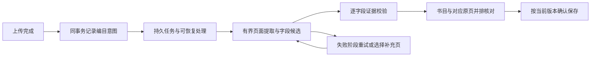

# 可靠书籍录入：实施方案与验收边界

日期：2026-09-27。工作树：`AcademicCloud-vnext`，恢复基线 `d0e2c79`。

状态：用户已要求优先解决录入可靠性；本文给出可实施的分阶段方案。
导出链路的错误分类及冗余打包已本地修复。2026-09-28 按 [ADR-046](../decisions/ADR-046-transactional-cataloguing-admission.md) 实现新准入与现有任务表的同事务交接；贡献26项（其中13项新增）及既有建议/HTTP/启动38项共64项验证通过，后端类型检查和独立审查通过。下面其余持久恢复、协议和模型的变更尚未实施，
应在对应阶段形成 ADR 和迁移/回退设计。外部 AI API、费用和资料外发尚未获授权。

## 要解决的产品问题

一本书上传成功后，用户应能看见它是否正在整理书目信息、哪些字段已经找到、
哪些需要核对，以及下一步如何完成。断网、关闭网页、计算机休眠或单个文件损坏，
不应使其他书籍丢失进度。录入质量应按书名、责任者、版本、出版信息分别验收。

“文件已保存”“处理任务已完成”“书目信息已确认”是三个不同事实。
现有原文件、资料身份、来源版本、人工确认和私有研究记录必须保留。

## 已核实的原因

| 问题 | 代码或现有证据 | 后果 |
|---|---|---|
| 网络故障被误报成解析失败 | 修复前 `catalog-batch-export.ts` 将 PDF inspector 的类型化错误统一改成 `inspection_failed`；resilient exporter 只重试 `source_unavailable` | 真实网络故障绕过已有的一次重试；本次修复 |
| 上传完成到创建编目任务之间没有持久交接 | `library-service.ts` 的入库后通知通过 `queueMicrotask` 执行并吞掉异常；启动修复只查已有 queued job | 特定退出/异常时序可能留下已上传但没有编目任务的书；静态审计，未声称生产已发生 |
| 导出依赖一条长期 HTTP 请求 | `catalog-bridge.ts` 在连接断开时取消处理并清空内存进度；结果在 resilient exporter 的数组中 | 已完成的书籍不能跨刷新/进程重启复用 |
| 逐页故障仍可终止整本证据提取 | `pdf-text.ts` 仅对已完成页面后的总时限耗尽保留部分结果 | 扫描封面或单页 OCR 故障可能使该书其他可用证据一起丢失 |
| 模型收到的信息有硬上限 | 默认前15/后5页；NuExtract 总输入8 KiB、每页1,024字符 | 未抽取到的字段可能从未进入模型输入，换模型也不保证解决 |
| 质量验收缺少独立真值 | 现有 `catalog-field-quality-and-abstention.md` | 结构、来源、安全弃答通过，不等于书目准确率已达标 |

单书 ZIP 随即丢弃、整批再压缩的冗余已通过分离提取与打包移除。
尚无测量证明它是主要耗时，不能把去重压缩当成总体性能结论。
Core 的导出 capability 有效期是24小时，而非一小时；其进程内存储会在重启后失效。

## 目标流程

### 1. 先保证上传和任务不会失联

- 在上传激活或准入的同一数据库事务中写入编目意图；事务失败则一并回滚。
- 由现有 Local Pull / durable job 机制领取意图。以资料、不可变 source generation、
  操作类型和处理版本约束重复调度。显式重新处理产生新尝试，不覆盖旧证据。
- 回调校验当前尝试、来源版本和有效权限；旧回调不应覆盖新来源或人工修改。
- 补偿器只恢复缺失交接和未完成尝试；不因服务重启重跑所有成功书籍。

优先复用现有队列、租约和 SQLite；不引入第二套消息服务。

### 2. 让处理独立于浏览器连接

- 发起操作快速返回任务身份；查询进度与读取结果分离。关闭网页只停止界面订阅，
  用户明确取消才取消任务。重新登录后按授权恢复当前进度。
- 每本书分别保存尝试、阶段、失败原因、已验证候选、页面身份和算法来源；
  一份损坏文件不阻塞其他书。失败重试只作用于明确失败项。
- 正常录入直接进入已有资料详情/书目审核。ZIP 是导出工具，不应成为正常录入的必经环节。
- 持久化优先复用现有合法候选结构和页面/证据摘要；原始 OCR 文本和页面图片仍不落库。
  如果要让证据 ZIP 本身跨重启精确续传，应另行定义临时材料的权限、期限、清除和
  来源失效协议，经过 ADR 后实现，不能暗中增加永久原文缓存。

### 3. 把证据覆盖和模型能力分别改进

- 先保留可用原生文本，再对确有必要的页面 OCR。记录未处理页和失败阶段，
  防止把部分提取显示为完整。
- 对导出审核可提出“部分页面可用”策略；共享自动编目路径仍需严格验证。
  OCR引擎故障、取消、来源变化、越权和校验失败不能一概当作可忽略页面错误。
- 在现有窗口和总输入预算内评估字段相关片段选择，避免固定前1,024字符遮住版权页关键行。
  记录字段是窗口外、截断、OCR失败、模型遗漏，还是被校验器拒绝。
- 无法覆盖的书提供用户选择题名页/版权页/牌记页的有界重试；这需要明确的请求及来源
  协议，不能以此自动扩展到整书 OCR。
- 抽取、角色/类型判断和保存分开。缺失字段可保留为空；冲突字段让用户比较来源。
  模型自评分或两次模型意见一致都不构成事实证据。

### 4. 以逐字段核对完成录入

- 复用已有 Preview/Apply、显式 set/clear、人工字段权威和 CAS；不另造一套保存入口。
- 书名、原作者、译者/校注者、版本、出版社、出版年、卷册和 ISBN 分别显示状态，
  点击来源页即可核对。古籍原作者、现代整理者、现代载体出版信息和历史底本信息分开。
- 有支持的字段可以成为可审核候选；类型 UNKNOWN 不应把整本书当作无效文件。
- “无需再处理”需要明确的人工确认或通过独立质量验证的自动策略；任务 HTTP 200
  不得让界面谎报“书目信息完整”。

### 5. API 采用可替换的推理适配器

当前默认仍是零新增费用的本地模型。外部 API 是否值得接入，应在同一冻结样本、
同一证据输入和同一字段评分下比较。接入方式应包含：

- 单独的 provider 配置、凭证管理、请求限额、费用上限、超时/重试和用量记录；
- 明确的资料外发范围；先选定字段所需的页面片段，禁止默认上传整书；
- 真正的模型/版本/prompt 来源记录及独立合约准入，不借用 NuExtract 的现有来源身份；
- 所有结果仍经过校验与人工权威保护；提供方不可直接写 canonical metadata。

只有在用户选择外部 API 并明确费用与外发范围后，才能执行真实调用。
本次未接入 API、没有新增费用，也没有向外部模型发送资料。

## 实施顺序与验收

| 阶段 | 可交付结果 | 必须证明 |
|---|---|---|
| R0：当前故障 | 导出错误正确分类和有界重试 | 临时网络故障恢复；持续故障最多两次；坏文件/加密文件/超限不重复处理；取消终止；后续书不受影响 |
| R1：可靠交接（新准入已本地验证） | 复用现有任务表的同事务交接与恢复；历史缺失/不可变来源编排未关闭 | 事务回滚、提交后立刻退出、重复完成上传、领取后退出均不漏任务、不重复写入；人工修改和来源替换安全 |
| R2：可恢复审核 | 逐书任务/结果与正常网页审核 | 刷新、断网、重启、权限撤销、重复提交和部分失败；已完成候选可恢复；旧来源拒绝应用 |
| R3：质量试验 | 逐字段真值、基线与改进比较 | 代表性来源和留出样本；区分证据覆盖/识别/推理/校验损失；公开分母和实际人工核对耗时 |
| R4：精确上线 | 受影响组件的发布与真实浏览器验收 | 正常上传→进度→对应原页核对→保存→刷新可见；再恢复一次中断；最后只处理未完成/受影响资源 |

建议先选24本有代表性的可读 PDF，并留出12本未用于调整的样本；数量是试验建议，
不是已存在的金标准。覆盖现代论著/历史整理本、原生文本/扫描件、多语言、卷册/版本，
只使用有合法来源和可核对原页的样本。每个适用字段标记支持、错误、遗漏、合理弃答，
不适用字段单独列出。真值核对不能由被测模型自行完成。

报告字段级 precision/recall、错误数、遗漏数、类型混淆、弃答率，以及每本人工核对
时间的中位数和P90。先建立基线，再在比较前冻结目标，不能事后调整分母来宣称通过。
评分单位在标注前冻结为字段与值；责任者等列表按独立条目评分，并分别核对角色。
precision = 正确且有支持的输出值数 / 所有输出值数；输出缺乏支持计为错误。
recall = 正确找回的真值数 / 原书中经独立核对确实存在的适用真值总数。
有真值却遗漏或弃答的项仍在 recall 分母中；不适用项排除并单独计数。
来源本身不可核对的样本单独报告，不能标成正确。再分别报告窗口覆盖、文本截断、
OCR和模型/校验造成的损失；仅对已覆盖证据计算的条件指标不能冒充整书 recall。
身份错配、无证据 canonical 晋升、人工信息覆盖、重复应用、跨账号泄露必须为零。

## 与 OCR 规划的协作

[OCR 产品规划](ocr-product-plan.md#8-与提升书籍录入可靠性的协作约定)及[Mongology 离线资格记录](ocr-mongology-qualification.md)已从独立检查点
`160230e455263b88b1d8c1dce789a20e7218a2ae` 集成到 vNext（cherry-pick `29b5760`）。
录入侧主写上传/准入持久意图、逐书恢复、Catalog 候选与审核应用、书目字段质量和集成状态；
OCR 侧主写引擎资格、汉文/蒙古文适配草案、逐页文本/布局/质量及 Reader 消费合同。
共享合同先交换 diff，不另建来源注册、入库、权限或消息系统。

共同使用 `resourceId/sourceId/physicalPage`；Catalog fingerprint/CAS 仍是单独的可变请求快照。
当前 Compute 与 Reader 页序均从1开始，仅 Mongology 的零起始 `source_page_index` 在适配边界转换。
OCR v1 仍返回 `ocr_deferred`；异步任务、完整源授权、逐页清单和布局扩展尚未实现。

48项原工程测试及两个现有模型各13条合成输入是接入方提供的离线运行证据，
不代表真实书籍文字质量或本项目产品验收。合成探针与[证据 JSON](../evidence/ocr-mongology-offline-20260927.json)
只用于离线资格复核；本次集成未重跑模型、处理真实文献、启用 OCR 或改变生产。

## 本次状态

2026-09-28：ADR047 补上正常资料库选中后的恢复入口；预览后显式提交缺失任务或两类安全基础设施失败。服务端在同一事务中验证整批权限及来源/任务/尝试快照，保护所有历史审核证据、成功任务和人工信息，排除六份已知坏源。后端59项、前端51项组件/API/文案及最终27项App/手机定向测试、类型检查、构建、独立审查和1440/390真实本地浏览器验收通过；尚未部署。手机Activity遮挡末行的缺陷一并修复。它不等于持久 ZIP/逐页恢复或书目质量验收。

Owner 新要求：完成此项后评估并推进正式 OCR 接入，提高书籍编目可靠性，并在`我的研究`提供当前页识别。先复用本地引擎、冻结源/页/私人结果和任务合同，再实测启用；不以已有合成探针宣称真实文字质量，也不自动扩展为全文索引或整库 OCR。

R0 修改为本地候选，具体测试结论记入活动任务；未发布到生产 Bridge。
R1 的新准入事务交接与 ADR047 显式选中恢复已本地实现，沿用现有 Catalog 指纹与任务期限，不等于完整的不可变 sourceId 编排，也不自动扫描补建所有历史缺失任务。持久 ZIP/逐页恢复及 R3–R4 尚未完成；新授权的当前页 OCR 接入先遵循上文已核查的源/页/私人任务边界。外部 API 费用及资料外发仍未获授权。本方案不宣称已彻底解决整条录入链路。
